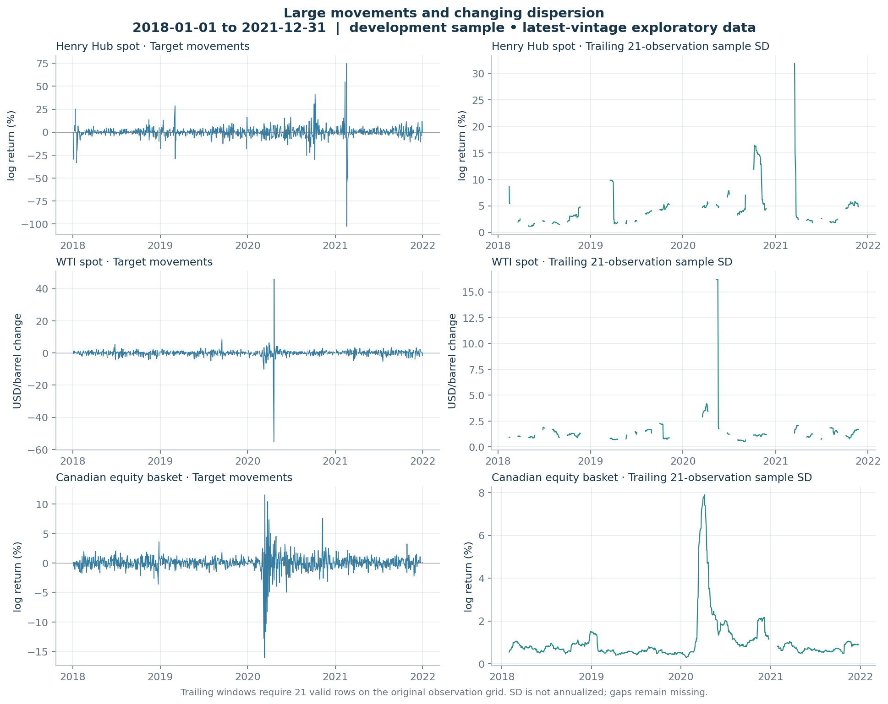
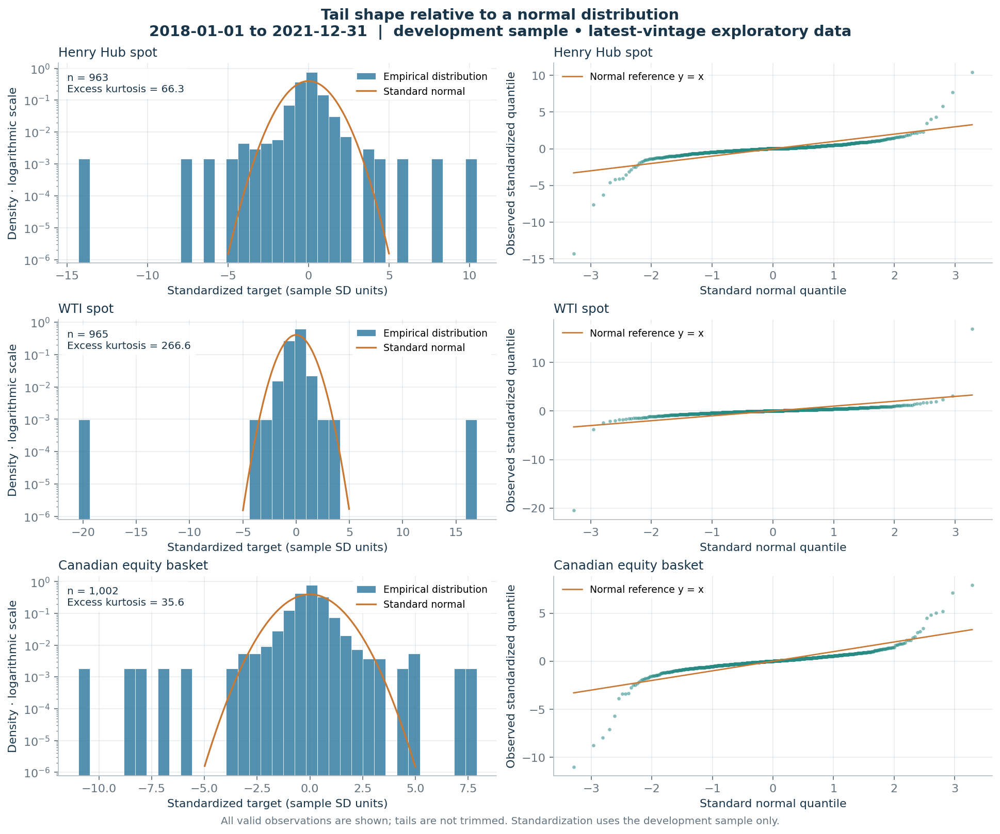
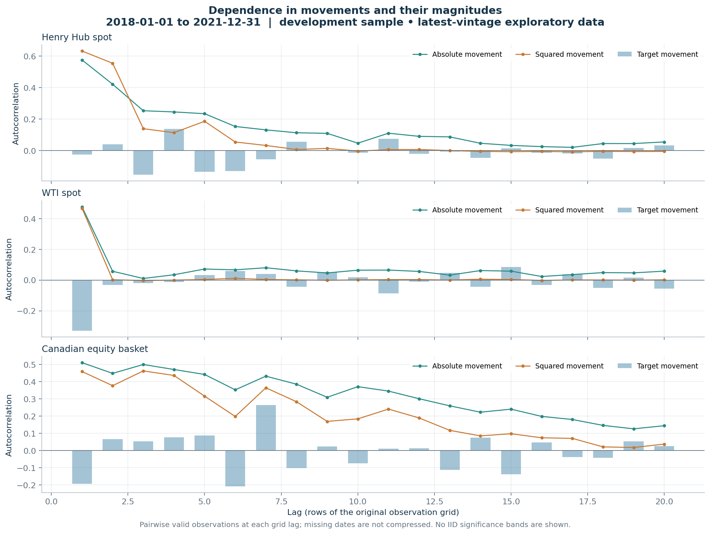
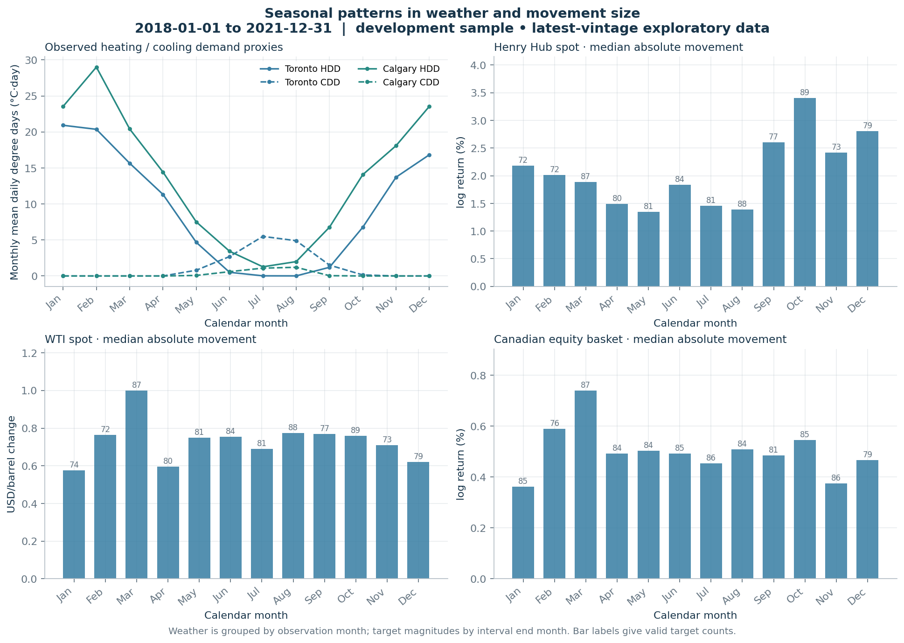
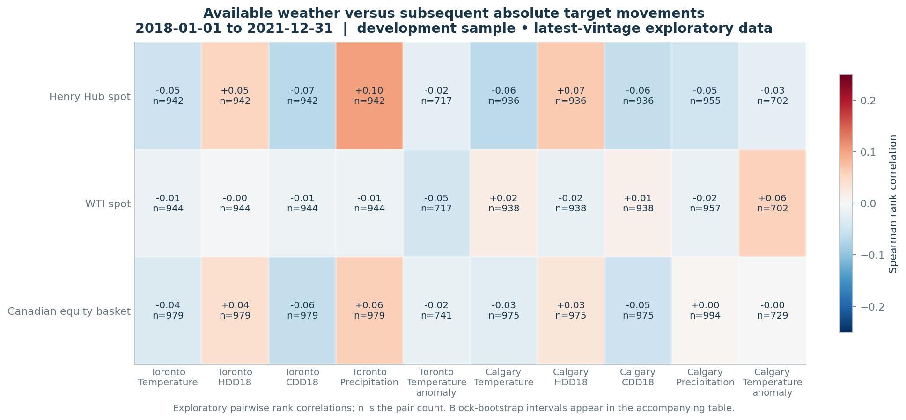

# Phase 2 exploratory evidence

Development interval: **2018-01-01 to 2021-12-31**. Tuning: 2022-01-01 to 2023-12-31; final test: 2024-01-01 to 2025-12-31. Later-period values are excluded before numeric analysis. Phase 1 already checked their data quality.

Latest-vintage observational analysis with assumed availability times. No forecast model or predictive-accuracy claim.

## Target definitions

Henry Hub and equities use 100 × log(Pₜ/Pₜ₋₁). WTI uses Pₜ − Pₜ₋₁ in USD/barrel so negative prices remain valid. The basket converts each equity log return back to a simple return, averages four fixed 25% weights, then applies log1p. It is a descriptive rebalanced basket before costs. Missing constituents are never reweighted.

Quote intervals longer than four calendar days and movements adjacent to explicit null prices are withheld. This conservative rule also excludes some legitimate holiday intervals; an exchange-calendar treatment is still required before forecasting.

| asset | n | unit | std | excess_kurtosis | acf1 | abs_acf1 | squared_acf1 |
|---|---|---|---|---|---|---|---|
| canadian_basket | 1002 | log return (%) | 1.459 | 35.603 | -0.194 | 0.511 | 0.459 |
| henry_hub_spot | 963 | log return (%) | 7.153 | 66.308 | -0.025 | 0.576 | 0.632 |
| wti_spot | 965 | USD/barrel change | 2.705 | 266.616 | -0.330 | 0.478 | 0.469 |

Kurtosis and autocorrelations are descriptive estimates; a few crisis observations can dominate them. Raw dispersion across percentage returns and dollar changes is not directly comparable. See subperiod_summary.csv for the predefined two-half sensitivity.

## Figures

## Weather timing and interpretation

The weather cutoff is 18:00 Toronto on the calendar day before the earlier price in each target interval. Thus both target endpoints occur after the origin. This intentionally conservative information horizon differs from a conventional next-close forecast. Weather enters only when its assumed available_at is at or before the origin, subject to staleness checks.

Temperature anomalies subtract the same-month mean from earlier calendar years in the development history, using at least 20 available reference observations. This is an expanding historical reference, not an official climate normal.

All 70 asset–feature pairs are reported. Correlations concern absolute target movements; signed correlations are also retained in the table. Intervals use paired moving blocks of 20 original observation-grid rows and 500 seeded resamples. Missing positions remain in that grid. Intervals are pointwise and exploratory, with no multiple-testing or nonstationarity guarantee. Shared seasonality, omitted market variables and US/Canadian geography prevent causal interpretation.

## Coverage and next gate

The pilot does not cover 2008 or 2014–16. Historical source expansion remains required for the originally requested regime analysis. No interpolation, winsorization, random train/test split, or test-period tuning is used. Before Phase 3, decide the final target horizon, exchange-calendar handling, historical coverage, and whether verified vintages can be obtained. Otherwise all later model comparisons must retain a latest-vintage research qualification.

## References

Return tails and nonlinear dependence: [Cont (2001)](https://www.stat.rice.edu/~dobelman/courses/texts/stylized.cont.2001.pdf). Benchmark negative prices: [EIA WTI daily data](https://www.eia.gov/dnav/pet/hist/RWTCD.htm). Revision history: [FRED real-time periods](https://fred.stlouisfed.org/docs/api/fred/realtime_period.html).
