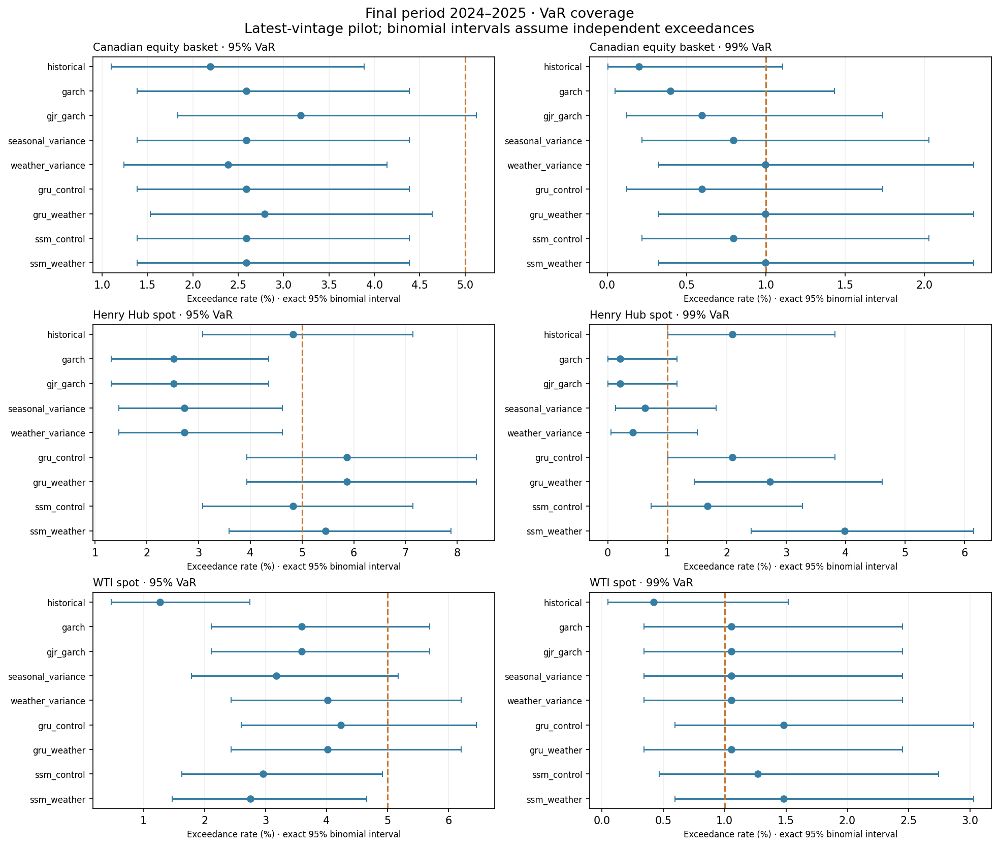
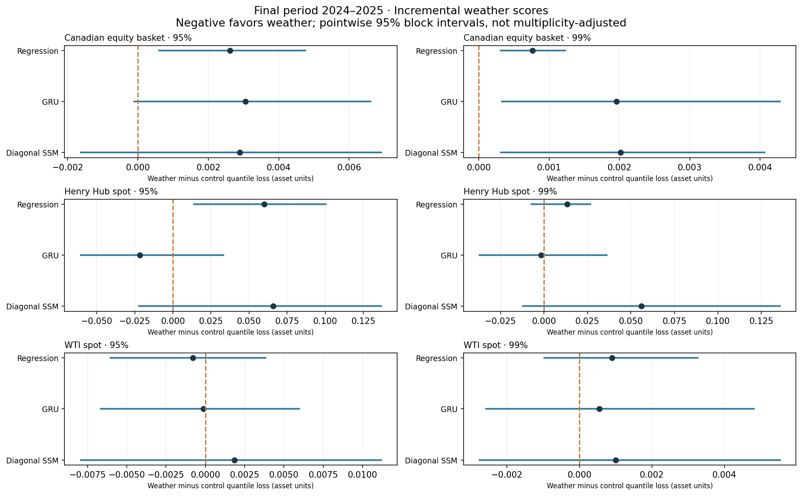

# Phase 5 final evaluation

**2024–2025 final period, under the sealed protocol. Latest-vintage research pilot; no point-in-time trading claim.**

All nine models and training settings were retained before first final-period access. Rolling refits can use earlier final-period labels only after maturity. These results must not be used to retune and then re-label the same period as untouched.

Forecast rows: 27882; failed: 0; skipped: 0.

## Common-date scores and coverage

| asset | model | confidence | common_scored_rows | exceedances | exceedance_rate | mean_quantile_loss | mean_qlike | mean_fz0 |
|---|---|---|---|---|---|---|---|---|
| canadian_basket | historical | 0.950 | 502 | 11 | 0.022 | 0.087 | 0.331 | 0.506 |
| canadian_basket | garch | 0.950 | 502 | 13 | 0.026 | 0.083 | 0.276 | 0.456 |
| canadian_basket | gjr_garch | 0.950 | 502 | 16 | 0.032 | 0.082 | 0.272 | 0.457 |
| canadian_basket | seasonal_variance | 0.950 | 502 | 13 | 0.026 | 0.087 | 0.365 | 0.516 |
| canadian_basket | weather_variance | 0.950 | 502 | 12 | 0.024 | 0.089 | 0.425 | 0.555 |
| canadian_basket | gru_control | 0.950 | 502 | 13 | 0.026 | 0.082 | 0.270 | 0.437 |
| canadian_basket | gru_weather | 0.950 | 502 | 14 | 0.028 | 0.085 | 0.348 | 0.487 |
| canadian_basket | ssm_control | 0.950 | 502 | 13 | 0.026 | 0.084 | 0.295 | 0.456 |
| canadian_basket | ssm_weather | 0.950 | 502 | 13 | 0.026 | 0.087 | 0.411 | 0.496 |
| canadian_basket | historical | 0.990 | 502 | 1 | 0.002 | 0.026 | 0.331 | 0.927 |
| canadian_basket | garch | 0.990 | 502 | 2 | 0.004 | 0.025 | 0.276 | 0.883 |
| canadian_basket | gjr_garch | 0.990 | 502 | 3 | 0.006 | 0.025 | 0.272 | 0.964 |
| canadian_basket | seasonal_variance | 0.990 | 502 | 4 | 0.008 | 0.027 | 0.365 | 1.017 |
| canadian_basket | weather_variance | 0.990 | 502 | 5 | 0.010 | 0.028 | 0.425 | 1.052 |
| canadian_basket | gru_control | 0.990 | 502 | 3 | 0.006 | 0.025 | 0.270 | 0.880 |
| canadian_basket | gru_weather | 0.990 | 502 | 5 | 0.010 | 0.027 | 0.348 | 0.999 |
| canadian_basket | ssm_control | 0.990 | 502 | 4 | 0.008 | 0.025 | 0.295 | 0.865 |
| canadian_basket | ssm_weather | 0.990 | 502 | 5 | 0.010 | 0.027 | 0.411 | 0.979 |
| henry_hub_spot | historical | 0.950 | 477 | 23 | 0.048 | 0.864 | 5.873 | 2.837 |
| henry_hub_spot | garch | 0.950 | 477 | 12 | 0.025 | 1.121 | 7.127 | 3.042 |
| henry_hub_spot | gjr_garch | 0.950 | 477 | 12 | 0.025 | 1.121 | 7.127 | 3.042 |
| henry_hub_spot | seasonal_variance | 0.950 | 477 | 13 | 0.027 | 0.936 | 5.807 | 2.913 |
| henry_hub_spot | weather_variance | 0.950 | 477 | 13 | 0.027 | 0.996 | 6.404 | 2.973 |
| henry_hub_spot | gru_control | 0.950 | 477 | 28 | 0.059 | 0.921 | 5.368 | 2.875 |
| henry_hub_spot | gru_weather | 0.950 | 477 | 28 | 0.059 | 0.899 | 5.846 | 2.850 |
| henry_hub_spot | ssm_control | 0.950 | 477 | 23 | 0.048 | 0.985 | 5.730 | 2.940 |
| henry_hub_spot | ssm_weather | 0.950 | 477 | 26 | 0.055 | 1.050 | 6.265 | 3.372 |
| henry_hub_spot | historical | 0.990 | 477 | 10 | 0.021 | 0.276 | 5.873 | 3.331 |
| henry_hub_spot | garch | 0.990 | 477 | 1 | 0.002 | 0.293 | 7.127 | 3.292 |
| henry_hub_spot | gjr_garch | 0.990 | 477 | 1 | 0.002 | 0.293 | 7.127 | 3.292 |
| henry_hub_spot | seasonal_variance | 0.990 | 477 | 3 | 0.006 | 0.249 | 5.807 | 3.198 |
| henry_hub_spot | weather_variance | 0.990 | 477 | 2 | 0.004 | 0.262 | 6.404 | 3.239 |
| henry_hub_spot | gru_control | 0.990 | 477 | 10 | 0.021 | 0.279 | 5.368 | 3.356 |
| henry_hub_spot | gru_weather | 0.990 | 477 | 13 | 0.027 | 0.278 | 5.846 | 3.346 |
| henry_hub_spot | ssm_control | 0.990 | 477 | 8 | 0.017 | 0.275 | 5.730 | 3.290 |
| henry_hub_spot | ssm_weather | 0.990 | 477 | 19 | 0.040 | 0.331 | 6.265 | 4.718 |
| wti_spot | historical | 0.950 | 473 | 6 | 0.013 | 0.174 | 1.770 | 1.288 |
| wti_spot | garch | 0.950 | 473 | 17 | 0.036 | 0.158 | 1.609 | 1.179 |
| wti_spot | gjr_garch | 0.950 | 473 | 17 | 0.036 | 0.158 | 1.609 | 1.179 |
| wti_spot | seasonal_variance | 0.950 | 473 | 15 | 0.032 | 0.163 | 1.659 | 1.226 |
| wti_spot | weather_variance | 0.950 | 473 | 19 | 0.040 | 0.162 | 1.648 | 1.218 |
| wti_spot | gru_control | 0.950 | 473 | 20 | 0.042 | 0.162 | 1.637 | 1.217 |
| wti_spot | gru_weather | 0.950 | 473 | 19 | 0.040 | 0.162 | 1.626 | 1.228 |
| wti_spot | ssm_control | 0.950 | 473 | 14 | 0.030 | 0.166 | 1.685 | 1.245 |
| wti_spot | ssm_weather | 0.950 | 473 | 13 | 0.027 | 0.168 | 1.671 | 1.251 |
| wti_spot | historical | 0.990 | 473 | 2 | 0.004 | 0.060 | 1.770 | 1.811 |
| wti_spot | garch | 0.990 | 473 | 5 | 0.011 | 0.052 | 1.609 | 1.785 |
| wti_spot | gjr_garch | 0.990 | 473 | 5 | 0.011 | 0.052 | 1.609 | 1.786 |
| wti_spot | seasonal_variance | 0.990 | 473 | 5 | 0.011 | 0.053 | 1.659 | 1.871 |
| wti_spot | weather_variance | 0.990 | 473 | 5 | 0.011 | 0.054 | 1.648 | 1.891 |
| wti_spot | gru_control | 0.990 | 473 | 7 | 0.015 | 0.054 | 1.637 | 1.851 |
| wti_spot | gru_weather | 0.990 | 473 | 5 | 0.011 | 0.055 | 1.626 | 1.922 |
| wti_spot | ssm_control | 0.990 | 473 | 6 | 0.013 | 0.055 | 1.685 | 1.870 |
| wti_spot | ssm_weather | 0.990 | 473 | 7 | 0.015 | 0.056 | 1.671 | 1.900 |

## Paired weather comparisons

Candidate-minus-control quantile loss: negative favors weather. Intervals are pointwise, from 20-row blocks; Holm p-values use all 165 prespecified score comparisons. See paired_comparisons.csv for all metrics and pairs.

| asset | candidate | confidence | mean | ci_low | ci_high | pvalue_holm |
|---|---|---|---|---|---|---|
| canadian_basket | weather_variance | 0.950 | 0.003 | 0.001 | 0.005 | 1.000 |
| canadian_basket | gru_weather | 0.950 | 0.003 | -0.000 | 0.007 | 1.000 |
| canadian_basket | ssm_weather | 0.950 | 0.003 | -0.002 | 0.007 | 1.000 |
| canadian_basket | weather_variance | 0.990 | 0.001 | 0.000 | 0.001 | 0.809 |
| canadian_basket | gru_weather | 0.990 | 0.002 | 0.000 | 0.004 | 1.000 |
| canadian_basket | ssm_weather | 0.990 | 0.002 | 0.000 | 0.004 | 1.000 |
| henry_hub_spot | weather_variance | 0.950 | 0.060 | 0.013 | 0.101 | 1.000 |
| henry_hub_spot | gru_weather | 0.950 | -0.022 | -0.061 | 0.034 | 1.000 |
| henry_hub_spot | ssm_weather | 0.950 | 0.066 | -0.023 | 0.137 | 1.000 |
| henry_hub_spot | weather_variance | 0.990 | 0.013 | -0.008 | 0.027 | 1.000 |
| henry_hub_spot | gru_weather | 0.990 | -0.002 | -0.038 | 0.036 | 1.000 |
| henry_hub_spot | ssm_weather | 0.990 | 0.056 | -0.013 | 0.136 | 1.000 |
| wti_spot | weather_variance | 0.950 | -0.001 | -0.006 | 0.004 | 1.000 |
| wti_spot | gru_weather | 0.950 | -0.000 | -0.007 | 0.006 | 1.000 |
| wti_spot | ssm_weather | 0.950 | 0.002 | -0.008 | 0.011 | 1.000 |
| wti_spot | weather_variance | 0.990 | 0.001 | -0.001 | 0.003 | 1.000 |
| wti_spot | gru_weather | 0.990 | 0.001 | -0.003 | 0.005 | 1.000 |
| wti_spot | ssm_weather | 0.990 | 0.001 | -0.003 | 0.006 | 1.000 |

## Calibration and uncertainty

calibration_scores.csv contains exact binomial, Kupiec, transition independence, conditional coverage and relative ES residual diagnostics, including raw/adjusted p-values, intervals and unavailable reasons. Tests use shared valid dates; missing grid positions break transition pairs and remain missing within bootstrap blocks. ES/FZ0 require positive ES. Each diagnostic has its own 54-test Holm family. Binomial tests assume independent hits; LR references and the block bootstrap are approximate. Sparse 99% tails, missing quotes, nonstationarity and repeated model fitting limit power. Failure to reject is not model approval; score improvement does not establish calibration.

## Provenance and limitations

protocol_seal.json and first_access_audit.json preserve the local pre-access records. Source snapshot, dependency lock, all forecasts, fitted parameters and 600 neural checkpoints are in the full run. Runs use the same preserved data; replays are reproduction, not additional holdout experiments. The observed quote grid, variable intervals, assumed availability, revised history, selected-survivor basket and Gaussian tails remain. No 2008/2014–2016 evaluation, currency portfolio P&L, futures roll, transaction costs or execution claim is supported here.

See protocol.md for the prespecified formulas, families and primary sources.
